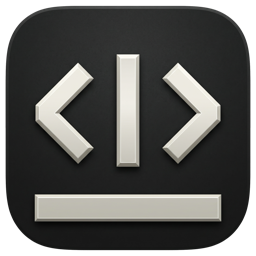

<p align="center">
  
</p>

<h1 align="center">DocType</h1>

<p align="center">
  <a href="https://github.com/dockit-apps/doctype-app/releases">Download</a> · macOS 26 or later
</p>

A native macOS Markdown note app. Notes are plain `.md` files in a folder you choose: notebooks are subfolders, tags live in YAML frontmatter, and changes made outside the app (git, other editors, scripts) show up automatically. Nothing is stored anywhere else, so your notes stay readable on GitHub, in other editors and in any tool that reads Markdown.

**What it does**

- **Live Markdown editing.** Headings, emphasis, code, quotes, lists, tasks, links, images and tables are styled as you type, and the syntax is hidden except where the cursor is.
- **Tables are drawn as tables.** Each cell is edited in place, and Shift-Return starts a new line in a cell.
- **Images and files.** Images show inline and can be resized. Dropped or pasted files are copied into the notebook's `attachments` folder.
- **Library.** Notebooks (with nested folders), tags, full-text search that ignores case and accents, and task progress on each note.
- **Commands.** A command palette (⌘K), and keyboard shortcuts you can change in Settings (⌘,).
- **Safety.** Autosave writes atomically. If a note changes on disk while you have unsaved edits, a banner lets you choose a version, and the version you give up is saved as a conflict copy.

Status: the MVP is complete (all phases of [docs/PLAN.md](docs/PLAN.md)).

## Requirements

- macOS 26 or later
- Xcode 27 (Swift 6.4 toolchain)

## Build and run

1. Open `DocType.xcodeproj` in Xcode.
2. Select the **DocType** scheme and press ⌘R.

The `DocTypeCore` package and its one dependency (swift-markdown) are resolved by Xcode on the first build.

From the command line:

```bash
xcodebuild -project DocType.xcodeproj -scheme DocType -derivedDataPath build/DerivedData build
open build/DerivedData/Build/Products/Debug/DocType.app
```

On first launch, click **Choose Library…** and pick a folder of Markdown files, or an empty folder to start fresh. DocType remembers it, even if you move the folder later.

## Test

The rules (parsing, styling decisions, text edits, the library on disk, search, shortcuts) live in the `DocTypeCore` package:

```bash
cd DocTypeCore && swift test
```

The app tests type into a real editor (TextKit 2) and check cursor movement, styling, tables, undo and settings:

```bash
xcodebuild test -project DocType.xcodeproj -scheme DocType -derivedDataPath build/DerivedData
```

To run one Swift Testing test from the command line, include the parentheses: `-only-testing:"DocTypeTests/EditorTableTests/tabAndReturnMoveThroughCellsAndAddRows()"`. Without them, xcodebuild runs nothing and still reports success.

## Performance fixtures

Generate a fake 1,000-note library (plus one 5,000-line note) and run the performance checks against it, in a release build as users would run it:

```bash
swift Scripts/make-fixtures.swift ~/DocTypeFixtures
cd DocTypeCore && DOCTYPE_FIXTURES=~/DocTypeFixtures swift test -c release --filter PerformanceTests
```

To try the app with it, choose `~/DocTypeFixtures` as the library. The budgets and the latest measurements are in [ARCHITECTURE.md](ARCHITECTURE.md#performance).

## Project layout

- `DocType/`: the macOS app (SwiftUI and AppKit). Views, plus the models that connect them to core.
- `DocTypeCore/`: a local Swift package with the rules. It never imports SwiftUI or AppKit, so a future MCP server can use it without a UI.
- `DocTypeTests/`: app tests that drive a real editor.
- `Scripts/make-fixtures.swift`: generates the performance fixture library.
- `docs/PLAN.md`: the MVP plan, with the decisions made along the way.

See [ARCHITECTURE.md](ARCHITECTURE.md) for how the pieces fit together.

## License

MIT. See [LICENSE](LICENSE).
